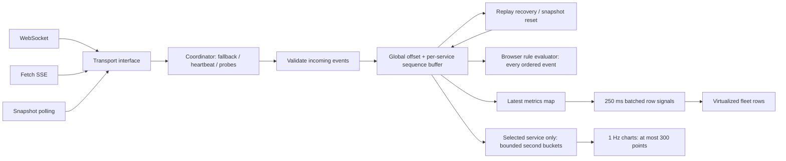

# Fleet Pulse

Angular **22.2.2** + FastAPI real-time operations dashboard. The UI is intentionally simple; most of the implementation is in the typed, testable recovery pipeline.

**Start with [WORKING.md](WORKING.md)** for a plain-language walkthrough of every module, data flow, failure case, and the important files to explain in a review.

## Setup

Prerequisites: Node **24.15.0** (or Angular-compatible Node ≥22.22.3 in the 22.x line), npm 10+, Python **3.13**, and optionally Docker Compose v2. The machine's original Node 22.15.0 is too old for Angular 22. Use `nvm install && nvm use` if you have nvm. Versions are pinned in `package-lock.json` and backend requirements.

From the repository root, terminal 1:

```sh
python3.13 -m venv backend/.venv
source backend/.venv/bin/activate
pip install -r backend/requirements.txt
uvicorn backend.main:app --host 127.0.0.1 --port 4000
```

Terminal 2:

```sh
cd frontend
npm ci
npm start
```

Open **http://127.0.0.1:4200**. The frontend proxies `/api/*` to FastAPI on port **4000**, including WebSocket upgrades and SSE. If another program occupies port 4200, stop that program or use `npm start -- --port 4201`. Use one backend worker because mock state is in memory.

Accounts (both passwords are `pulse123`):

- `operator@pulse.dev`: fleet, detail, settings, and rule administration.
- `viewer@pulse.dev`: fleet, detail, and settings. `/rules` is route-guarded and mutation APIs independently enforce the role.

Both tokens are memory-only; a full browser reload requires login. The return URL restores the requested route and table query parameters afterward.

### Docker

```sh
docker compose up --build
```

Frontend: http://localhost:4200. API: http://localhost:4000. Nginx serves the compiled Angular app and proxies `/api/`; its buffering is disabled for SSE. The backend health check gates frontend startup. Docker configuration is supplied; see verification notes below for what was actually run.

### Tests and checks

```sh
# From root
backend/.venv/bin/python -m pytest backend/tests -q

# From frontend/
npm test
npm run lint             # ng lint, Angular ESLint
npm run format:check
npm run build
```

`npm test` is noninteractive Vitest. Tests exercise ten concurrent expired-token requests, refresh failure, retry classification/attempt limits/Retry-After, transport fallback and upgrades with fake transports/timers, heartbeat/offline behavior, ordering, duplicate rejection, gap detection, validators including async uniqueness, chart reduction, and alert episodes. Backend tests cover the HTTP contract and a real test-client WebSocket. GitHub Actions runs lint, format, tests, and build.

## Architecture



- `frontend/src/app/core/`: API/auth, configuration and types, transport adapters, coordinator state machine, integrity buffer, rule evaluator, chart reduction, validators, and shared store.
- `frontend/src/app/features/`: lazy standalone login, fleet, detail/charts, rules, and settings components.
- `backend/main.py`: API contract, generator, stream subscriptions, auth and chaos; in-memory by design.
- `docs/`: validation and review notes.

Angular Signals own UI state. A dedicated Web Worker owns transports, parsing, ordering, deduplication, replay processing and rule evaluation. RxJS delivers batches of points for the selected service and implements debounced cancellable async validation. OnPush plus per-service signals isolate row updates. Feature routes keep charts and rules out of the initial bundle. A fourth transport implements the existing factory/sink boundary without changing consumers.

## Resilience decisions

### R1 — transport fallback

WebSocket is first. Three consecutive failures or a five-second connect timeout lead to fetch-based SSE. Three SSE failures lead to snapshot polling every two seconds. While connected on a lower transport, a higher transport is probed every 30 seconds. The current transport stays active until the probe produces valid data. Polling climbs to SSE, then WebSocket; full climb can take two probe intervals.

Reconnect delays use exponential backoff with 50–100% jitter, capped at 30 seconds. Valid server pings reset the failure count; a handshake alone does not prove health. A watchdog closes a connection after roughly 10.5–11 seconds without a ping. Offline events close active/probe transports and suspend reconnects; online starts WebSocket immediately. All paths close timers, readers, sockets, and request controllers on logout.

Production: add operational metrics, credential exchange for stream URLs, and real user/device network testing. Browser background timer throttling can delay watchdog execution.

### R2 — integrity

Every frame is schema-checked. Invalid JSON/fields increment a counter with rate-limited console warnings. Inside the worker, events are buffered by global offset and drained in order, with per-service sequence checks. Duplicates never reach charts or rules. An unresolved gap gets one second for shuffled arrivals before recovery. Replay requests are single-flight and replay processing yields every 500 events.

Replay also runs after reconnect and after each polling snapshot. **Polling does not silently jump over intermediate events:** its snapshot triggers ordered replay so alert duration evaluation still sees the events between snapshots. HTTP 410 or inconsistent per-service sequencing reloads a snapshot, resets alert timers, explicitly announces the discontinuity, and reloads the detail history. The reorder buffer is capped at 15,000; overflow requires an announced snapshot reset.

Validation and replay decoding now run in a Web Worker. Production: paginate/chunk large replay windows and use a durable stream with a documented retention policy. The given contract returns replay as one JSON body, so a five-minute recovery at 2,000 events/s is large; this is an explicit performance risk.

### R3 — HTTP

Every finite API attempt has a 10-second deadline. GETs retry network failures and 429/502/503/504, up to **three total attempts**. `Retry-After` supports seconds and HTTP dates. POST retries require an idempotency key; rule creation supplies one and the backend caches its original result. PUT/DELETE are not retried. All authenticated requests carry the bearer access token.

A rejected expired token triggers a shared refresh promise. Ten failures wait for one refresh; late failures using an older token reuse the already-rotated token. Each request is replayed once after refresh. Refresh failure aborts the session lifetime, stops the stream, clears session state, and returns to login with a return URL.

The assignment's `http=500:50` drill mentions retried reads, but R3 explicitly excludes 500. This implementation follows the exact retry allowlist: **500 is surfaced immediately**, not retried.

Production: refresh via Secure/HttpOnly/SameSite cookies and add CSRF protection as appropriate. This mock contract returns a refresh token in JSON, so both tokens stay in memory rather than browser storage.

### R4 — honest degradation

Connection health and last metric timestamp remain visible. A global stale indicator and per-row/service stale markers use the actual event timestamp, with a 10-second threshold. Existing values remain visible during disconnects. History, fleet, rules, and chart failures have explicit error/retry states. Chart creation/update errors are caught inside each chart panel; table and transport continue independently. Pending rule saves update the visible list optimistically; evaluation continues against confirmed rules and a rejected save restores the previous list.

Production: add full end-to-end accessibility tests, telemetry with sampling, error tracking, and stronger chart-boundary tests across actual browser/library failures.

## Performance

See [docs/VERIFICATION.md](docs/VERIFICATION.md) for observed results, limitations, and the exact remaining Chrome measurement procedure. **Unmeasured targets are not claimed as passed.**

Implementation choices:

- 480 px virtual viewport, 40 px rows, 120–240 px overscan: about 18–24 attached row elements, not 2,000.
- 2,000 latest metric records and signals; the worker publishes at most four times/second. Only one unacknowledged display batch is allowed; newer display values are coalesced while the UI is busy. Only visible row components subscribe to their metrics.
- Name-sorted tables do not recompute sorting on every metric batch. Metric sorting/status filters explicitly depend on the batched revision.
- Detail subscribes to worker batches for one service and retains at most ~901 per-second points. Three-second mean buckets reduce the 15-minute window to at most 300 points per chart; means smooth noise but can conceal narrow spikes. Rule evaluation always uses original events, never chart averages.
- Chart rendering is capped at 1 Hz with animation disabled. Histories merge by second; live data wins over a late REST response. Route changes abort old history and immediately hide any data tagged with another service ID.
- Incident list is capped at 200. Rule evaluation state is proportional to services × saved rules; it is cleared when confirmed rules change. The server retains approximately five minutes of replay, not an ever-growing history.

## Mock backend

FastAPI on Python 3.13. The generator runs in 20 ms batches, fairly rotating through 2,000 services with plausible latency, error percentage, throughput, and status. All streams share the same offset/sequence source. Five minutes of replay is retained; pre-start history is synthetic and generated deterministically, overlaid with observed per-second values where available. Rules and tokens are intentionally not durable across backend restarts.

The required endpoints are implemented, including the stretch backend `/telemetry` and `/assistant/stream`. No extra public endpoints or fields are required. `/docs` and `/openapi.json` are framework-generated and protected by the same middleware. Additional rule fields are preserved as required. Refresh credentials expire after 24 hours as a mock safeguard. A per-connection higher `rate` raises shared generation while that subscriber exists; because this mock has one globally ordered feed, it is intended for single-reviewer drills rather than independent multi-tenant rate control.

### Chaos switches

```sh
curl -X POST http://localhost:4000/chaos -H 'Content-Type: application/json' -d '{"ws":"down"}'
curl -X POST http://localhost:4000/chaos -H 'Content-Type: application/json' -d '{"ws":"down","sse":"down"}'
curl -X POST http://localhost:4000/chaos -H 'Content-Type: application/json' -d '{"ws":"silent"}'
curl -X POST http://localhost:4000/chaos -H 'Content-Type: application/json' -d '{"ws":"drop:20","chaos":"shuffle,dupe,garbage:5","rate":2000}'
curl -X POST http://localhost:4000/chaos -H 'Content-Type: application/json' -d '{"token_ttl":5}'
curl -X POST http://localhost:4000/chaos -H 'Content-Type: application/json' -d '{"http":"500:50"}'
curl -X POST http://localhost:4000/chaos -H 'Content-Type: application/json' -d '{"http":"429"}'
curl -X POST http://localhost:4000/chaos -H 'Content-Type: application/json' -d '{"http":"slow:11000"}'
curl -X POST http://localhost:4000/chaos -H 'Content-Type: application/json' -d '{"kill":10}'
curl http://localhost:4000/chaos
curl -X DELETE http://localhost:4000/chaos
```

POST merges switches: reset between independent drills. `token_ttl` affects tokens issued after the switch; log out/in to start that drill immediately. Streaming URLs also accept per-connection overrides and `access_token`, as specified. Do not paste real production credentials into these mock URLs.

## Trade-offs and shortcuts

- Minimal functional UI; no decorative design work. Hand-written SCSS, Angular Material buttons/theme, native labeled inputs, semantic ARIA table, and visible focus.
- Browser in-app accessible notifications, not OS notification permission prompts.
- No assistant frontend, circuit breaker/secondary server, offline cold-start cache, draft restore, multi-tab coordination, or 5/60-minute selector. These are stretch items.
- No persistent auth or data across restart. Backend is a mock, not production infrastructure.
- All telemetry/assistant backend endpoints exist, but no frontend telemetry pipeline is enabled.
- Only configured local origins are allowed by CORS; normal frontend traffic uses the same-origin proxy.
- Chrome 4× CPU/30-minute memory acceptance and Docker runtime validation must be completed before claiming submission-ready performance. See verification report.
- This workspace had no Git repository or remote. Focused local commits on `feat/resilient-dashboard` document the implementation, but a GitHub repository, reviewer access, and actual PRs require a user-provided remote/reviewer identities. [docs/PR-NOTES.md](docs/PR-NOTES.md) provides a concrete trade-off description for the eventual PR; it is not a fabricated PR.

## AI usage

Implemented with OpenAI Codex for architecture, frontend/backend code, automated tests, local verification, and explanatory documentation. Review `WORKING.md` alongside the source; the goal is that you can explain and modify the implementation rather than memorize generated code.

## Web Worker update

The main thread no longer receives every raw metric event. `stream.worker.ts` owns WebSocket/SSE/polling coordination, `StreamProcessor` owns event integrity and alert evaluation, and `StreamClient` connects the worker to Angular. `stream-protocol.ts` defines the typed messages.

The main thread retains the single authenticated API client. Worker snapshot/replay requests return transferable `ArrayBuffer` bodies; JSON decoding happens in `WorkerApi`, inside the worker. Worker stream token refresh delegates to the same `ApiClient.refresh()` used by forms and history requests, preserving exactly one concurrent refresh.

Every 250 ms the worker sends changed rows, capped incidents, diagnostics and per-second points for the selected service. An acknowledgement prevents message queue growth if the UI is busy. Route selection generations reject stale chart batches. Logout/retry terminates the worker and aborts bridge requests. Worker errors remain visible with Retry; there is no silent fallback to main-thread event processing.

The worker changes do not establish the unmeasured 4× CPU or 30-minute performance targets. They remove stream parsing, ordering and rule evaluation from the UI thread; rendering and selected-service charts still use the main thread.
# emplay_test
